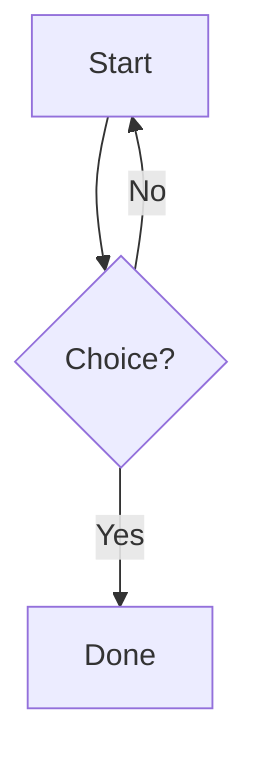

# GFM Feature Test

## 1. Table + Alignment
| Left | Center | Right |
| :--- | :----: | ----: |
| a    | b      | c     |

## 2. Task List
- [ ] unchecked
- [x] checked lowercase
- [X] checked uppercase

## 3. Strikethrough
~~gone~~ still here

## 4. Extended Autolinks (no angle brackets)
https://example.com — www.example.com — someone@example.com

## 5. Mentions + Emoji
Thanks @octocat :tada: :rocket: :sparkles:

## 6. Footnotes
Claim with a footnote.[^1] And another.[^long]

[^1]: First footnote.
[^long]: Second one, named.

## 7. Alerts
> [!NOTE]
> Blue, informational.

> [!TIP]
> Green, helpful.

> [!IMPORTANT]
> Purple, key info.

> [!WARNING]
> Yellow, caution.

> [!CAUTION]
> Red, danger.

## 8. Syntax Highlighting
```python
def hello(name: str) -> None:
    print(f"hi {name}")
```

## 9. Mermaid


## 10. Math
Inline: $E = mc^2$

$$
\int_0^\infty e^{-x^2}\,dx = \frac{\sqrt{\pi}}{2}
$$

## 11. Raw HTML Handling
Inline `<kbd>Ctrl</kbd>+<kbd>C</kbd>` — should render as keys.

<script>alert("should be escaped, not run")</script>

<iframe src="https://example.com"></iframe>

## 12. Details / Summary
<details>
<summary>Click to expand</summary>

Hidden content lives here.

- even a list
- inside details

</details>

## 13. Anchor Link
Jump back to [section 2](#2-task-list).

## 14. Hard Break (two spaces)
line one  
line two
