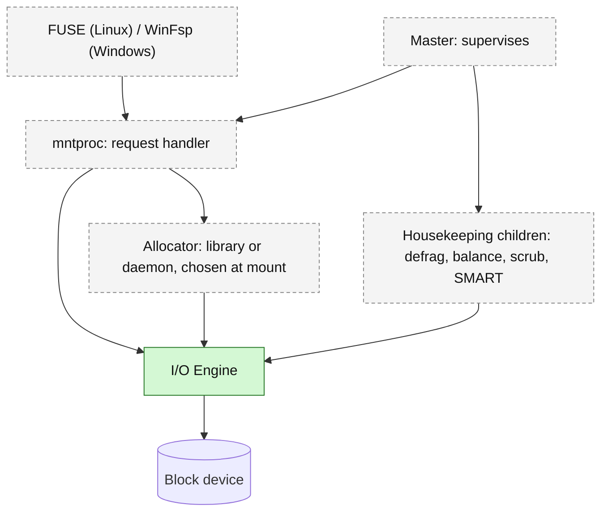

# Configurable Adaptive FileSystem (CAFS)

A (Linux Kernel and) ZFS-inspired, config-first filesystem for consumer drives.

> [!WARNING]
> Proof of concept (pre-Alpha). Not production-ready. The on-disk format can still change, so don't store data you can't lose on a CAFS volume.

> [!NOTE]
> Kernel driver is a placeholder. Isn't a priority for the time being.

> [!IMPORTANT]
> No software can fix a failing drive. CAFS can only try to delay data loss.

## What it is

CAFS aims to bring customizability and adaptability to consumer drives: health-aware block allocation driven by SMART data, two-tier deduplication, and an anchor/recovery design that only duplicates what actually matters. The configuration surface is the point — most design decisions are exposed as parameters rather than baked in.

Currently at PoC stage: the I/O Engine builds and passes tests. Everything else is unbuilt.

### How the pieces fit (planned)

Green exists today; dashed is planned. Everything that touches the device goes through the I/O Engine.



## Two builds

| Build | IPC | Guardrails | For |
|---|---|---|---|
| Release | Per-interface, CAFS-controlled | On | Normal use |
| Custom | One standard messaging format | Off | See below |

**Custom** exists for people who want to plug CAFS into their own system, swap the allocator or any other module, or drive it over a standard messaging format instead of the per-interface IPC that Release uses internally. It ships as source only — anyone building Custom is already compiling.

## What works right now

- **PoC I/O Engine** — Rust, at [`Src/FUSE/Linux/x86-64/I-O_Engine/`](Src/FUSE/Linux/x86-64/I-O_Engine/). Anchor mount lifecycle, generic block read/write. `cargo test` passes.
- **`mkfs_cafs`** — format tool, built as a bin target inside the engine crate.
- **`smart_handler.py`** — shared SMART telemetry processor at [`Src/`](Src/).

Not built yet: allocator, FUSE request layer, dedup table, WAL.

Out of scope for the proof of concept: hard links, snapshot reads, and the optional Windows TRIM helper.

### Where the design stands

- [`Docs/fs.info`](Docs/fs.info) — on-disk format, byte-for-byte. Canonical.
- [`Docs/DECISIONS-FORMAT-8.md`](Docs/DECISIONS-FORMAT-8.md) — decisions for the current format revision.
- [`Docs/OPEN_ITEMS.md`](Docs/OPEN_ITEMS.md) — everything still undecided.
- [`Docs/BUILD_PLAN.md`](Docs/BUILD_PLAN.md) — how the I/O Engine is being built and tested, brick by brick.

## Repo layout

```text
cafs/
├── Docs/
│   ├── fs.info                 on-disk format spec — canonical
│   ├── config.fs               config format + crash-criticality
│   ├── allocator.md            allocator design
│   ├── io_engine.md            I/O Engine rules
│   ├── error_id.md             error identifiers
│   ├── DECISIONS-FORMAT-8.md   decisions for the current format revision
│   ├── OPEN_ITEMS.md           everything still undecided
│   ├── BUILD_PLAN.md           brick-by-brick build and test plan
│   ├── ADR/                    decision log: never deleted, only superseded
│   └── Research/               informs decisions, isn't one
├── Src/
│   ├── smart_handler.py        shared: Kernel + FUSE
│   ├── FUSE/
│   │   ├── Linux/x86-64/I-O_Engine/   Rust PoC — the only buildable component
│   │   └── Windows/                   placeholder
│   └── Kernel/                 placeholder (GPL-2.0-only)
│       ├── Linux/
│       └── Windows/
├── Tools/                      check.py, test helpers
├── .github/                    CI pipeline
├── LICENSE
├── LICENSES/                   BSD-3-Clause, GPL-2.0
├── Makefile                    provisional
└── README.md
```

Critical files:

- [`Docs/fs.info`](Docs/fs.info) — on-disk format, byte-for-byte. Canonical.
- [`Docs/config.fs`](Docs/config.fs) — config file format and crash-criticality per section.
- [`LICENSE`](LICENSE) / [`LICENSES/`](LICENSES/) — BSD-3-Clause repo-wide; GPL-2.0-only for `Src/Kernel/` only.

Repo conventions and the full layout rationale: `cafs-repo-structure-2026-09-03.md`.

## Building

The only buildable component today is the I/O Engine:

```bash
cd Src/FUSE/Linux/x86-64/I-O_Engine
cargo build
cargo test
```

The root `Makefile` is provisional and may not work.

A workspace root is planned so `cargo build` works from the repo root, but it isn't set up yet.

## Releases & versioning

| Phase | Tag | GitHub flag | Artifacts |
|---|---|---|---|
| Alpha | none | — | none |
| Beta | `v0.1.0-beta.dev1` | pre-release | yes |
| RC | `v0.1.0-rc1` | pre-release | yes |
| Release | `v0.1.0` | latest | yes |

Each tagged release includes:

| Artifact | What it is |
|---|---|
| `source.tar.gz` | Release + Custom source. Build it yourself. |
| `installer_linux.sh` | Bootstrap. Downloads `portable.zip`. |
| `installer_win_x86.exe` | Self-contained Windows installer. |
| `installer_win_amd64.exe` | Self-contained Windows installer. |
| `portable.zip` | Offline bundle: Release binaries + docs. |

Custom ships as source only, inside `source.tar.gz`.

<details>
<summary>AI disclosure</summary>

AI is used to generate code from the specs in Docs/. Alpha builds may not be fully reviewed. Beta and release builds are checked before tagging.

Bug reports and advice welcome.

</details>

## License

BSD-3-Clause repo-wide. GPL-2.0-only for `Src/Kernel/` only. See [`LICENSE`](LICENSE) and [`LICENSES/`](LICENSES/).

Kernel code builds as separate binaries; userspace never links against it. The optional Windows kernel helper (a planned TRIM relay) will not be code-signed, so loading it will need Test Mode or a Secure Boot change; CAFS works without it.

### Third-party notices

On Windows, CAFS uses **WinFsp - Windows File System Proxy, Copyright (C) Bill Zissimopoulos** ([github.com/winfsp/winfsp](https://github.com/winfsp/winfsp)), under its GPLv3 free/open-source exception. A closed-source Windows build of CAFS would need its own WinFsp commercial licence.
